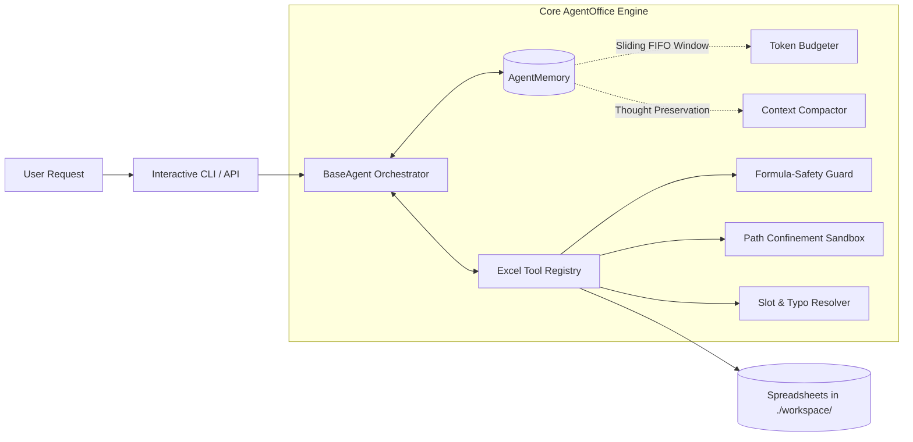

<div align="center">

# AgentOffice

### The Deterministic, Sandboxed Excel Engine for Autonomous LLMs

*Prevent silent formula destruction, directory escapes, and context exhaustion when LLMs interact with spreadsheets.*

[](https://github.com/venk-ee/agentoffice/actions/workflows/ci.yml)
[](https://coderabbit.ai)
[](https://github.com/venk-ee/agentoffice/security/dependabot)
[](tests/)
[](https://github.com/astral-sh/ruff)
[](LICENSE)
[](https://www.python.org/downloads/)

[Architecture](#architectural-pillars) • [Quickstart](#quickstart) • [The Problem](#the-problem-with-raw-llm-spreadsheet-execution) • [Programmatic Usage](#programmatic-usage) • [Test Matrix](#test-suite--verification)

</div>

---

## The Problem with Raw LLM Spreadsheet Execution

When LLMs interact with spreadsheets through unconstrained code execution (e.g., Code Interpreter), three critical failure modes occur:

| Enterprise Risk | Unconstrained LLM Behavior | AgentOffice Guarantee |
| :--- | :--- | :--- |
| **Formula Obliteration** | Blindly overwrites `=SUM(B2:B50)` or `=XLOOKUP(...)` with static numbers. | **Formula Guard**: Identifies `data_type == 'f'` and halts destructive writes without explicit intent. |
| **Path Traversal / Escape** | Arbitrary scripts can traverse directories (`../../`) or mutate host files. | **Strict Sandbox**: All paths are canonicalized against `./workspace/`. Traversal attempts are rejected before disk access. |
| **Token Exhaustion** | Dumps thousands of raw tabular rows into context, bloating costs and latency. | **Memory Compaction**: Sliding-window FIFO history with automatic reasoning preservation and tool-output clamping. |

AgentOffice provides a structured execution runtime designed specifically for reliable spreadsheet automation.

---

## Architectural Pillars



### 1. Hardened Workspace Sandboxing
Every workbook operation passes through an isolated path resolver. The agent cannot read, inspect, or modify any file outside the designated `./workspace/` boundary.

### 2. Formula-Preserving Write Pipeline
`agentoffice` parses underlying XML cells with `openpyxl`. If a cell contains a dynamic formula, raw value injection is halted immediately, protecting dependent calculations from corruption.

### 3. Sliding-Window Memory Compaction
- **Thought Preservation**: Preserves the agent's internal reasoning chains while compacting verbose execution histories.
- **Safe FIFO Slicing**: Truncates history strictly at clean dialogue turns to avoid orphaning tool response schemas.
- **Output Clamping**: Large tabular payloads are capped (`max_tool_chars`) to maintain consistent inference latency.

### 4. Named Slot Discovery & Typo Resolution
Spreadsheets frequently contain inconsistent headers. When an agent queries a missing slot identifier (e.g., `totall_rev`), `agentoffice` performs fuzzy string distance matching to suggest the correct identifier before failing.

---

## Quickstart

### 1. Installation

Requires Python `>=3.11` and [`uv`](https://github.com/astral-sh/uv).

```bash
# Clone the repository
git clone https://github.com/venk-ee/agentoffice.git
cd agentoffice

# Install dependencies using uv
uv sync

# Configure credentials
cp .env.example .env
# Set OPENAI_API_KEY inside .env
```

### 2. Interactive CLI Shell

```bash
uv run agentoffice
```

```text
AgentOffice Interactive Terminal Shell (AGPLv3)
Type 'exit' or 'quit' or Ctrl+C to close.
--------------------------------------------------

You: Read the financial_model.xlsx and update the Q4 Tax Rate to 21%

[Tool] inspect_workbook({"file_name": "financial_model.xlsx"}) -> {"sheet_names": ["Income Statement", "Tax Schedule"], "active_sheet": "Income Statement"}
[Tool] update_workbook({"file_name": "financial_model.xlsx", "operations": [{"action": "set_cell", "sheet": "Tax Schedule", "cell": "B4", "value": 0.21}]}) -> {"status": "success", "modified_cells": 1}

Agent: I have updated the Q4 Tax Rate in 'Tax Schedule' (B4) to 21%. All dynamic tax liability formulas referencing B4 updated automatically.
```

---

## Programmatic Usage

Integrate `agentoffice` into existing backend pipelines or agent orchestrators:

```python
from pathlib import Path
from agentoffice.core.agent import BaseAgent
from agentoffice.tools.excel import create_excel_tools

# 1. Point to your isolated spreadsheets directory
workspace = Path("./workspace").resolve()
tools = create_excel_tools(workspace)

# 2. Instantiate agent with your chosen model
agent = BaseAgent(
    model="gpt-4o-mini",
    tools=tools,
    system_prompt="You are an autonomous spreadsheet operations assistant.",
)

# 3. Execute tasks deterministically
result = agent.run(
    "Read regional sales from q3_report.xlsx and update the total sum in C21"
)
print(result)
```

---

## Test Suite & Verification

AgentOffice is built with deterministic offline unit tests that execute without network dependencies or external API tokens:

```bash
uv run pytest --cov=agentoffice
```

Run `pytest tests/` to verify all tests pass.

---

## Roadmap & Ecosystem Expansion

`AgentOffice` is expanding from an Excel execution engine into a unified, sandboxed **Autonomous Office Suite**:

- [x] **Excel (`.xlsx`) Engine**: 69 passing tests, formula-guards, workspace sandboxing, sliding memory compaction.
- [ ] **Document Engine (`.docx`)**: AST-aware Word document editing with style, table, and template preservation.
- [ ] **Presentation Engine (`.pptx`)**: Layout-aware slide deck generation, master slide typography retention, and automated data charts.
- [ ] **PDF Intelligence (`.pdf`)**: Structured table extraction, deterministic form filling, and OCR layout reconstruction.
- [ ] **Modern Web UI / Diff Inspector**:
  - Interactive web interface featuring side-by-side sheet diff preview before committing mutations.
  - One-click rollback for cell changes.
  - Real-time token consumption and function-call timeline.
- [ ] **Containerized Deployment**: Production Docker image and docker-compose sandbox for isolated headless runs.

---

## Repository Structure

```
agentoffice/
├── agentoffice/
│   ├── core/
│   │   ├── agent.py         # Autonomous agent execution loop & function calling
│   │   └── memory.py        # Token tracking & FIFO memory compaction engine
│   ├── interface/
│   │   └── chat.py          # Interactive CLI terminal shell with tool telemetry
│   └── tools/
│       └── excel/
│           ├── guards.py    # Formula overwrite and cell type safety checks
│           ├── inspect.py   # Sheet and workbook structure discovery
│           ├── read.py      # Range and cell reading with format preservation
│           ├── workspace.py # Path sandboxing and containment logic
│           └── write.py     # Safe atomic cell and slot modification
├── tests/                   # 69 unit and integration test fixtures
├── workspace/               # Sandboxed directory for safe spreadsheet I/O
├── .github/
│   ├── workflows/ci.yml     # Fast uv-powered Ruff and PyTest CI
│   └── dependabot.yml       # Weekly dependency upgrade automation
├── .coderabbit.yaml         # Autonomous agent safety review instructions
├── pyproject.toml           # Packaging metadata & entrypoints
└── LICENSE                  # GNU Affero General Public License v3 (AGPLv3)
```

---

## License & Commercial Inquiries

This project is open-sourced under the **GNU Affero General Public License v3 (AGPLv3)**.

- **Open-Source Use**: If you build on or integrate AgentOffice into network services or open projects, you are free to do so under the copyleft terms of the AGPLv3.
- **Commercial Licensing**: If your organization requires proprietary, closed-source deployment without AGPLv3 reciprocal disclosure, contact the author for commercial licensing terms.

---

<div align="center">
  <b>Built by <a href="https://github.com/venk-ee">Venkat</a></b>
</div>
